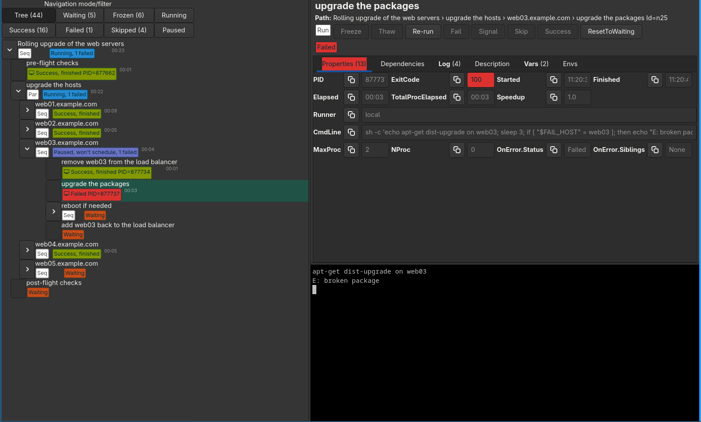

# runtree

[](https://github.com/nagylzs/runtree/actions/workflows/build.yml)
[](go.mod)
[](LICENSE)
[](https://github.com/nagylzs/runtree/commits/main)

**`make -j` for operations, where every job is a terminal you can step into.**

runtree runs the steps of an operations task (upgrading a fleet of servers, a deployment, a build pipeline) as a tree
of commands: in order where they must be, in parallel where they can be, on this machine or on other hosts over ssh.
Every command runs in its own live terminal, and a GUI shows the whole tree, so you can watch it, answer a prompt, and
when something fails: pause, fix it, re-run the step, and let the automation continue. It is for sysadmins and
developers whose upgrades and deployments are mostly automated, but still need a person now and then.



**Install:** `brew install nagylzs/runtree/runtree` (macOS; on Linux without the GUI), or the programs of the
[releases](https://github.com/nagylzs/runtree/releases) (Linux, macOS, and Windows without the GUI). See
[Installation](#installation).

## Features

- **Trees of steps:** `seq` and `par` nodes, reusable objects with `include`, repetition with `for_vars`, variables
  and conditions, in plain YAML.
- **A live terminal for every step:** colors, progress bars and prompts work; type into any of them.
- **Error handling for operations:** a failed step can pause and wait for you, freeze the rest of a rollout, or be
  allowed to fail; re-run a single step, skip, thaw, or reset a subtree.
- **Coordination across the tree:** dependencies (`provides` / `requires`), exclusive and shared locks, and a limit
  on the parallel processes of any subtree.
- **Runs anywhere you can ssh to:** locally, or on any host over ssh; runtree uploads its small runner to the host
  (Linux and macOS, x86 and ARM), there is nothing to install there. Connections are shared per host.
- **History:** every event and the terminal output of every step can be saved in SQLite, and queried with SQL.
- **Safe to operate:** lock files against concurrent runs, confirmation before closing a running tree or pasting
  multi-line text into a terminal, graceful termination of the processes.
- **Without the GUI too:** `runtree-headless` runs the same trees in CI or from cron, with the output of every step
  on stdout and an exit code that tells how the run ended (it also stops when nothing can go on, e.g. frozen nodes).
- **Editor support:** a JSON Schema, a language server and a VS Code extension, with errors as you type.

## Why runtree

Many tools run commands for you, and most of them assume that a step either works on its own or fails. Operations are
often messier: a package asks a question, a host needs a look before the rollout goes on, a step fails and you would
rather fix it by hand and go on than start over.

- **CI systems** (Jenkins, GitHub Actions, GitLab CI) run pipelines of steps, but the output of a step is a log that
  you cannot type into. They are the better choice when nobody should be needed at all.
- **Configuration management and runbook automation** (Ansible, Rundeck) reach many hosts, and Ansible keeps them in
  a declared state, but the commands that they run cannot ask you anything, and you follow the run in its log. They
  are the better choice for keeping a fleet in a known state.
- **Terminal multiplexers and process managers** (tmux with tmuxinator, mprocs, process-compose) give every process a
  live terminal, but they are made mainly to keep the services of a development environment running on one machine.
  They are the better choice for that.

runtree sits between them: a tree of steps that runs to its end, every step in a real terminal that you can step
into, here or on other hosts over ssh, with you in the loop when you are needed; and the same tree runs unattended
with [`runtree-headless`](docs/headless.md) when you are not.

## Example

A rolling upgrade of five web servers, two at a time, that stops when one of them fails:

```yaml
tree:
  title: "Upgrade the web servers"
  max_proc: 2                          # two hosts at a time
  children_on_error: [paused, freeze]  # a failed host pauses, the hosts not started yet are frozen
  for_vars:
    host: [web01, web02, web03, web04, web05]
  par:
    - include: upgrade_host

upgrade_host:
  title: "{host}"
  runner: "ssh://root@{host}"          # run the steps on the host
  children_on_error: failed
  seq:
    - [apt-get, update]
    - [apt-get, -y, dist-upgrade]
    - title: "reboot if needed"
      seq:
        - title: "is a reboot needed?"
          on_error: [success, skip]    # no: skip the rest of this seq
          args: [test, -f, /var/run/reboot-required]
        - [systemctl, reboot]
        - title: "wait until it is back"
          runner: local
          args: [sh, -c, "sleep 10; until nc -z -w1 {host} 22; do sleep 1; done"]
```

```bash
runtree --check upgrade.rt.yaml   # check it without running anything
runtree upgrade.rt.yaml           # run it
```

The [examples](examples/README.md) go from the simplest tree to this one, step by step.

## Installation

With [Homebrew](https://brew.sh), on macOS (with the GUI) and on Linux (without the GUI):

```bash
brew install nagylzs/runtree/runtree
```

The [releases](https://github.com/nagylzs/runtree/releases) have the programs for Linux (amd64), macOS (Apple
silicon) and Windows (without the GUI): unpack the archive and put the programs in your `PATH`. The GUI needs GTK 4,
VTE and socat from your system (`brew install gtk4 vte3 socat` on macOS). Or build it from source, with Go 1.25+, GTK
4 and VTE development packages:

```bash
sudo apt install -y build-essential pkg-config golang git python3 socat \
    libgtk-4-dev libvte-2.91-gtk4-dev libgirepository1.0-dev     # Debian / Ubuntu
git clone https://github.com/nagylzs/runtree.git
cd runtree
python3 scripts/build.py      # the binaries are in dist/linux/amd64/
```

See [Getting started](docs/getting-started.md) for the details and other distributions.

## Documentation

- [Getting started](docs/getting-started.md)
- [Writing tree files](docs/tree-files.md) · [Variables and the environment](docs/variables.md) ·
  [How a tree runs](docs/execution.md) · [Dependencies and locks](docs/coordination.md)
- [The GUI](docs/gui.md) · [Runners](docs/runners.md) · [Logs and history](docs/logging.md) ·
  [Running trees in practice](docs/practice.md) · [Running without the GUI](docs/headless.md)
- Reference: [node properties](docs/reference/properties.md) · [command line](docs/reference/cli.md) ·
  [editor support](docs/editors.md)
- [Development](docs/development.md) · [TODO](TODO.md)

## Status

runtree is used for real upgrades and deployments, but it is young: the versions before 1.0 are development
releases, and the tree format, the options and the runner protocol may still change between minor versions. Use the
same version of runtree and of the `rtrunner`s that you install by hand (managed ssh runners are uploaded by runtree,
so they always match; a different version is a start error, not a silent one). The GUI runs on Linux and macOS; the
runner (`rtrunner`) and `runtree-headless` (without the GUI, e.g. for CI) also run on Windows. There is a Homebrew
tap; Linux packages are planned.

## License

runtree is free software, distributed under the [GNU General Public License v3.0](LICENSE).
