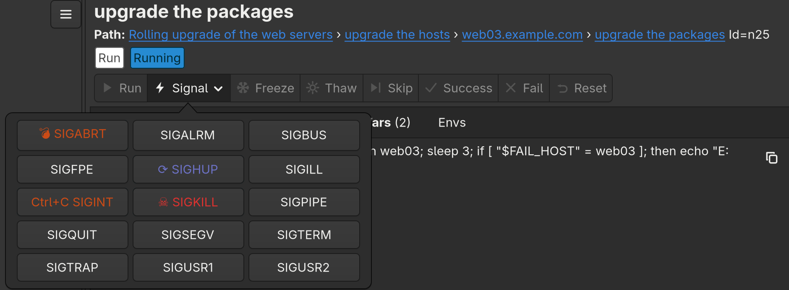
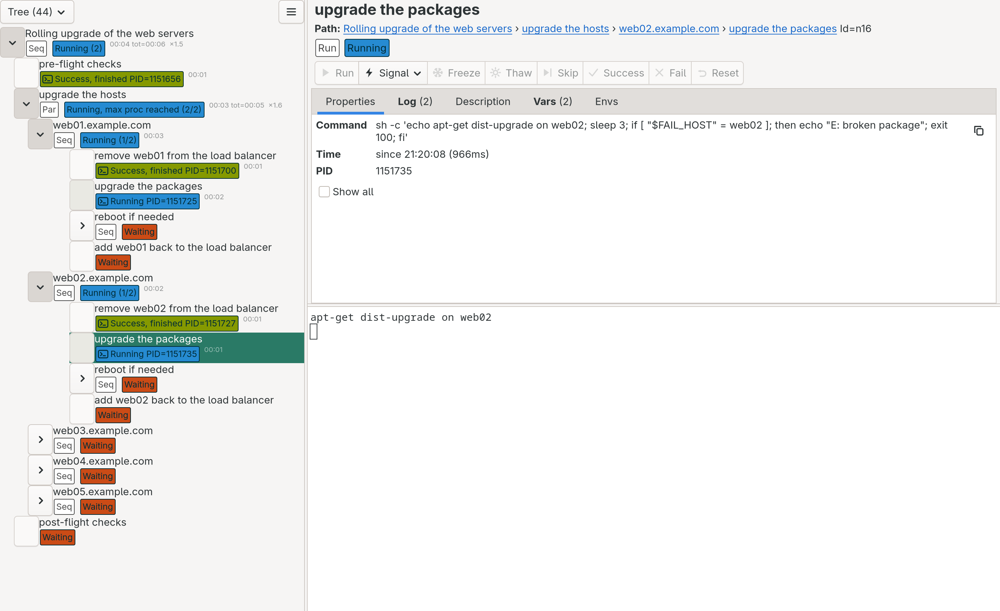

# The GUI

The window has two parts: the tree on the left, and the selected node on the right (the divider between them can be
dragged).


## The tree

Each row is a node: its title (or command line), its type (`Seq`, `Par`), its status, and its times:

- the status, with details: the number of running processes below it (`Running (2)`), the number of failed run nodes
  (`1 failed`), why it waits (`blocked`, `max proc reached`, `won't schedule`), `connecting` while a process is being
  started, and the pid of the process. A seq or par node is `stopped` when nothing runs below it and the rest waits
  for you: e.g. `Running, stopped: 1 paused, 1 frozen` when a failed host of a rollout is paused and the hosts after
  it are frozen;
- the elapsed time (of the last run, when the node was run again); for seq and par nodes also the total time of the
  processes below it (`tot=`) and the speedup that the parallel runs gave (`×2.0`);
- a terminal icon for the run nodes that have a terminal.

The button above the tree chooses the view: **Tree** shows the whole tree, the others (Waiting, Frozen, Running,
Success, Failed, Skipped, Paused) list the nodes in that status, with their numbers; **Blocked** lists the nodes that
wait for a [required resource or a lock](coordination.md) (its properties tell which one, and who holds the lock). A
check box limits the lists to run nodes.
The nodes that may need you are counted next to them in every view: a red ✕ with the number of the failed nodes and a
violet ⏸ with the number of the paused ones (only when there are any, counted like their lists); a click opens their
list.
In a list, the location button of a node shows it in the tree: it switches to the Tree view, opens the parents of the
node, selects it, and scrolls to it.

Three properties control which nodes are shown opened: `expanded` (show the sub-nodes when the tree is loaded,
`false` by default), `expand_on_active` (open the node when it becomes active, `true` by default) and
`collapse_on_finished` (close it when it finishes, `true` by default).

When the tree files have [warnings](tree-files.md#checking-a-tree-file), a banner above the tree tells it; its
**Show warnings** button lists them.

## The selected node

The top of the right side shows the title and the path of the node, its type and status (the tooltip explains the
status), and the [operation buttons](#operations). The nodes of the path are links: a click shows that node in the
tree. Below them are the tabs:

| Tab | Shows |
|-----|-------|
| Properties | what is looked for first: the result (exit code, or why it could not start), the command line, the runner and the working directory, the times, the PID while it runs, the progress of a seq or par node (running, finished and failed run nodes), the settings that differ from the default (`timeout`, `on_error`, `max_proc`, `success_exit_codes`...), and what the node requires and provides, its locks, and what it waits for. **Show all** adds the details: the default settings, the start and finish times, the process time of the sub-nodes, the message of the scheduler |
| Log | the [events](logging.md#events) of the node and the nodes below it (of the whole tree for the root). It follows the end of the log; when it is scrolled up, the **End** button in its corner scrolls to the end and follows it again |
| Description | the `description` of the node |
| Vars | the variables of the node, and where each value comes from |
| Envs | the environment variables that the node sets |

The values can be selected and copied; the long ones (command line, runner, working directory) have a copy button.

## Terminals

Every started run node has a terminal below the tabs: the terminal of its process. It is a real terminal: programs
can use colors, ask questions, show progress bars, and you can type into it.

- **Copy** and **Paste**: Ctrl+Shift+C and Ctrl+Shift+V (on macOS Cmd+C and Cmd+V too), or the context menu (right
  click), which has **Select All** too. Selecting with the mouse and pasting with the middle button works as in other
  terminals (in programs that use the mouse, e.g. vim with `mouse=a`, Shift and the middle button pastes).
- Pasting text with line breaks asks for confirmation first, with a preview: pasted into a shell, it can run
  commands.
- The terminal stays when the process exits, so its output can be read later. The output can also be saved, see
  [Logs and history](logging.md#saving-the-log).

## Operations

The buttons of the selected node perform operations on it. A button is enabled when the operation is allowed in the
status of the node; its tooltip tells what it does. **Signal** opens the list of the signals. For a seq or par node,
**All** opens the same operations for every node of the subtree, where they are allowed (e.g. **Freeze** there freezes
the waiting run nodes below it), and the signals for all of them.

The buttons have an icon and a text. When the texts do not fit (e.g. a large font, a narrow window), only the icons
are shown; **Text** or **Icons** in the [menu](#appearance) (or `--buttons=text`, `--buttons=icons`) shows always the
texts or only the icons.



| Operation | Allowed (run nodes) | What it does |
|-----------|---------------------|--------------|
| Freeze | Waiting | the scheduler does not start the node until it is thawed |
| Thaw | Frozen | the node is Waiting again |
| Run / Re-run | any status but Running | starts the node now: also a frozen, paused or finished one (Re-run), even when `max_proc` is reached or its requirements are missing; its locks must be free |
| Signal | Running | sends a signal (chosen from a list, e.g. SIGINT for Ctrl+C, SIGTERM, SIGKILL) to the process and the commands that it runs (its process group), like Ctrl+C in a terminal. On Windows only SIGINT (Ctrl+C typed into the pseudo console) and SIGKILL work |
| Fail / Success | Paused | sets the final status of a paused node |
| Skip | Waiting, Frozen | the node is Skipped: finished without error, it is not started |
| Reset (to waiting) | Frozen, Paused, finished | the node is Waiting again, the scheduler starts it again when it can |

For seq and par nodes:

- **Skip** for a node that is not started yet (Waiting or Frozen): the node is Skipped, its sub-nodes are not started.
  **All › Skip** skips the sub-nodes too; on a running node it only skips the sub-nodes that are not started.
- **Thaw** and **Reset** for a node frozen by `status: frozen`, **Reset** for a skipped one: the
  status of the node is calculated from its sub-nodes again. A node that is frozen because its sub-nodes are frozen is
  thawed with **All › Thaw**.
- **Fail** / **Success** for a paused one. This status lasts until an operation is performed on the node or below it.
- The operations of **All** for the rest.

**Re-run** and **Reset** unprovide the resources that the node (and its parents that become unfinished)
provided, so the nodes that require them wait for the new run. When there are such resources, a dialog lists them:
unprovide all of them (the default), or choose the ones to unprovide. A resource that is kept stays available, and the
nodes that require it can start right away. Resetting a node also clears the error of its previous start (e.g. when
its runner could not be reached).

## Closing runtree

When the tree has run nodes that are not finished successfully (not Success or Skipped), closing the window asks for
confirmation: to avoid closing it by accident, you have to type the result of a small addition. Ctrl+C in the terminal
that started runtree (SIGINT), and closing that terminal (SIGHUP), close the window the same way, and so does quitting
on macOS (Cmd+Q, the Quit menu item, the Dock).

When runtree exits, it stops starting nodes, terminates the processes that still run (SIGINT, then SIGTERM and SIGKILL
after 10 seconds each), and waits for them, so that their exits are logged. The window closes right away, the
messages are printed on the terminal that started runtree. See [signals and exit](practice.md#signals-and-exit).

`runtree --exit-on-finish` exits by itself when the root node is finished (Success, Failed or Skipped): a banner
above the tree, in the color of the status, counts down 10 seconds, so that the people who watch the window see the
result. **Stay open** keeps runtree running (until you close it), and the countdown stops when the root is started
again (e.g. Re-run). Its exit code tells how the tree ended, like the one of
[`runtree-headless`](headless.md#exit-codes): 0 when the root is Success (or Skipped), 2 when it is Failed, 3 when the
window was closed before the root finished. A script can run trees in the GUI one after the other this way:

```bash
runtree --exit-on-finish prepare.rt.yaml && runtree --exit-on-finish upgrade.rt.yaml
```

## Appearance

The menu (☰, above the tree) chooses the appearance:

- **System**, the default: the color scheme of the desktop, from the settings portal on Linux (GNOME, KDE...) and
  from the appearance of macOS. It follows the changes. When it is not known (e.g. on a VNC server without a
  desktop), it is dark.
- **Dark** or **Light**.



It asks GTK for the dark or the light variant of the theme, and runtree's own colors (the rows of the tree, the
signals) and the terminals follow the theme in use: a theme that has only a dark variant (e.g. `GTK_THEME=Dracula`)
keeps the dark colors whatever the choice is, and the menu tells it. (With GTK 4.20 and later, the choice also wins
over the variant of `GTK_THEME`, e.g. `Adwaita:dark`.)

The menu also chooses how the [operation buttons](#operations) are shown. The choices are saved in
`runtree/settings.json` in the configuration directory of the user (`~/.config` on Linux, `~/Library/Application
Support` on macOS); `--appearance` and `--buttons` override them for one run. On a HiDPI screen, `GDK_SCALE=2`
doubles the size.
